  <h1>Mahith</h1>
  
AI &amp; ML student building computer-vision tools and useful software.

  

    
    
    
    
  

## About Me

Hey, I’m Mahith — an AI &amp; ML student at Woxsen University who enjoys building things with code and exploring how technology works.

## Tech Stack

**AI & LLMs** 
      

**Machine Learning, Data & NLP** 
                  

**Computer Vision** 
       

**Languages** 
       

**Web & Mobile** 
         

**Backend & Data** 
          

**Cloud & Developer Tools** 
      

**Automation & Scraping** 
     

**Game Development** 
  

## GitHub Stats

<!-- Generated from GitHub's contribution calendar, profile, and public repository languages. -->

  
   
  

