  <h1>Mahith</h1>
  
AI &amp; ML student building computer-vision tools and useful software.

  

    
    
    
    
  

## About Me

- I work across **computer vision, machine learning, full-stack development, and automation**.
- Currently studying **AI &amp; ML at Woxsen University** and building **VeriSight**, a media-verification tool.
- Co-founder of **Omnicore Inc** and R&amp;D Head of the Woxsen Science Club.

## Socials

[Portfolio](https://ddssmahith.netlify.app) · [LinkedIn](https://www.linkedin.com/in/d-d-s-s-mahith) · [Email](mailto:ddssmahith11@gmail.com) · [GitHub](https://github.com/DDSSMahith)

## Tech Stack

- **AI &amp; LLM engineering** · LLM API integration, RAG, LangChain, AI automation, model evaluation
- **Machine learning &amp; data science** · Scikit-learn, Pandas, TensorFlow, Keras, PyTorch, neural networks, CNNs, time-series analysis, predictive modeling, model optimization, Matplotlib, data visualization
- **Computer vision** · OpenCV, facial recognition, image classification, deepfake and media analysis
- **Programming languages** · Python, JavaScript, TypeScript, Java, SQL, C#
- **Web &amp; backend** · React.js, Next.js, Node.js, Express.js, FastAPI, REST APIs, HTML5, CSS3
- **Databases &amp; cloud** · PostgreSQL, MySQL, MongoDB, AWS, Docker, Vercel
- **Automation &amp; tools** · n8n, Make.io, Apify, Git, GitHub, Unity

## GitHub Stats

<!-- Generated from GitHub's contribution calendar, profile, and public repository languages. -->

  

Updates automatically every 6 hours. Chart motion plays when the SVG loads.
