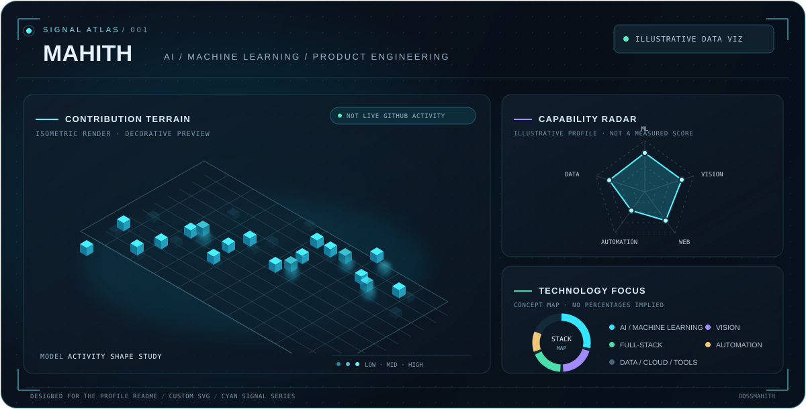

<!--
  GitHub profile repository for @DDSSMahith.
  A profile README appears when this repository is public and has the same name as your username.
-->

  

  
  
  

 

  <samp>AI / MACHINE LEARNING ENGINEER &nbsp;·&nbsp; BUILDING INTELLIGENT PRODUCTS</samp>

 

## `01` &nbsp; SYSTEM PROFILE

I'm **Mahith** — an AI and machine learning engineer who likes bringing models out of notebooks and into useful products. My work spans computer vision, LLM integrations, full-stack development, and workflow automation.

- 🎓 &nbsp; B.Tech Computer Science, AI & ML — Woxsen University, 2023–2027 · **9.20/10 CGPA**
- 🧠 &nbsp; Building with **Python, PyTorch, TensorFlow, TypeScript, React, and FastAPI**
- ⚙️ &nbsp; Interested in **computer vision, applied AI, automation, and data-rich tools**
- 🛰️ &nbsp; Research & Development Head, Woxsen Science Club · **Smart India Hackathon 2025, Round 2**
- 🌐 &nbsp; Co-founder of **Omnicore Inc**

## `02` &nbsp; SELECTED BUILDS

| Project | What it does | Stack |
|:--|:--|:--|
| **VeriSight** | Media verification with AI-generation analysis, image stability checks, and explainable visual maps. | React · TypeScript · FastAPI · PyTorch |
| **LexAssist** | A jurisdiction-aware legal research workspace with matter tracking and regulatory updates. | Next.js · TypeScript · PostgreSQL · OpenRouter |
| **Carbon Impact Analyser** | Identifies everyday objects and estimates their carbon impact from an image. | TensorFlow · MobileNetV2 · OpenCV · Streamlit |

## `03` &nbsp; ENGINEERING TOOLKIT

  
  
  
  
  
  
  
  
  
  
  
  

## `04` &nbsp; FIELD NOTES

- **VeriSight** — reached 95% accuracy with a checksum-pinned image classifier; added explainable image analysis and downloadable reports.
- **NullClass** — developed CNN facial-recognition models with 93.4% accuracy.
- **Wise Mango** — built n8n lead-generation workflows that improved reported efficiency by 207.3%.
- **Indico Labs** — contributed to a report-automation platform and AI-assisted chart generation.

  Designed to think clearly, build carefully, and keep shipping.

